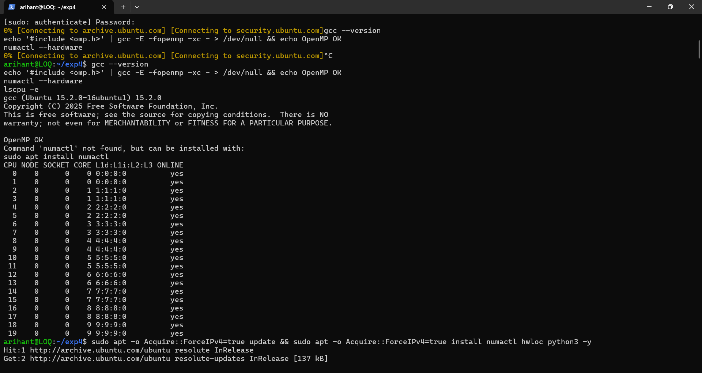
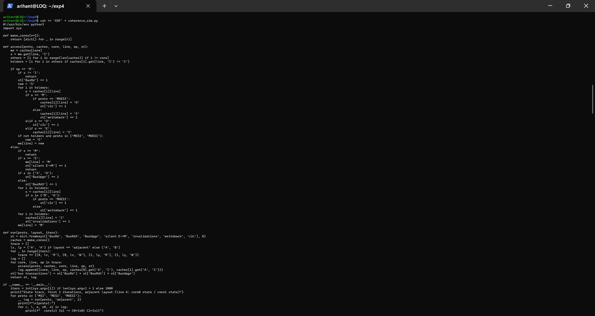
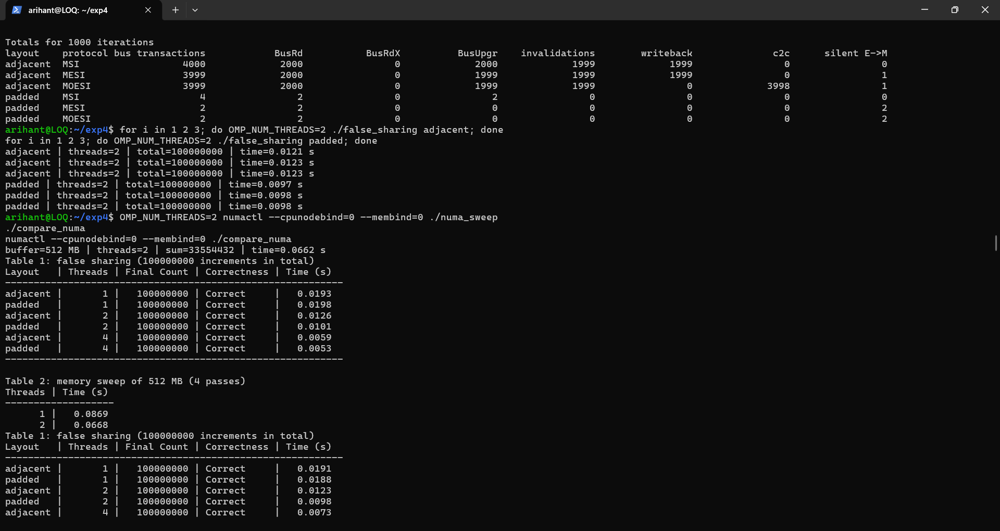
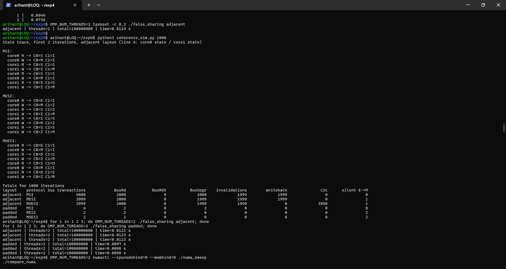
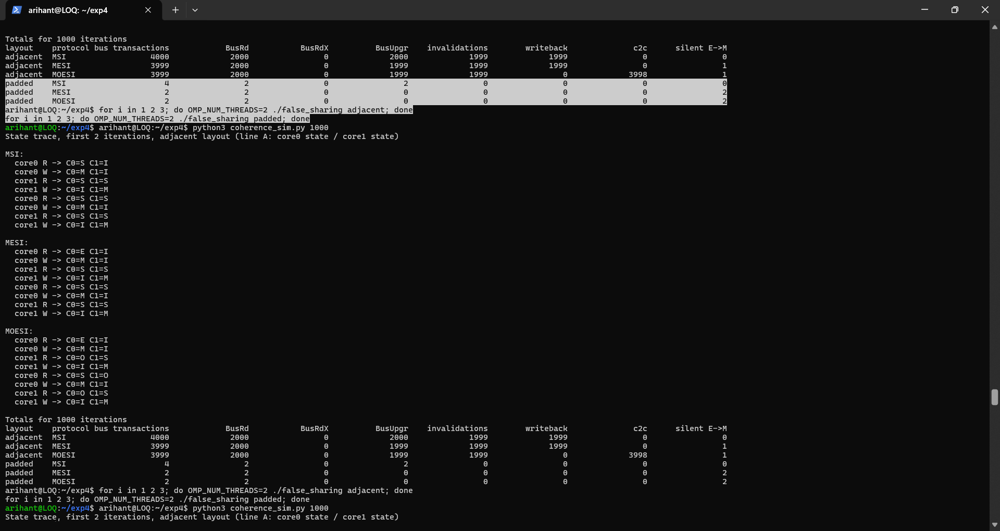

# PGC Lab 4: Cache Coherence (MSI, MESI, MOESI) and NUMA Memory Access Performance

Evaluating snooping cache coherence protocols (`MSI`, `MESI`, `MOESI`), 64-byte cache-line false sharing (`adjacent` vs `padded` layouts), and NUMA memory placement (`numactl`) on multi-core hardware.

---

## Repository Structure

| File / Directory | Description |
| :--- | :--- |
| [`coherence_sim.py`](coherence_sim.py) | 2-core snooping-cache protocol simulator comparing `MSI`, `MESI`, and `MOESI` across `adjacent` (shared line `A`) and `padded` (separate lines `A`, `B`) layouts. |
| [`false_sharing.c`](false_sharing.c) | OpenMP microbenchmark performing `100,000,000` counter increments across threads using either `adjacent` (`stride=1`, 8 bytes apart) or `padded` (`stride=8`, 64-byte cache-line aligned) layouts. |
| [`numa_sweep.c`](numa_sweep.c) | OpenMP memory sweep across a 512 MB buffer (4 passes, 64-byte stride) with first-touch page allocation controlled via `numactl`. |
| [`compare_numa.c`](compare_numa.c) | Combined benchmark runner generating Table 1 (false sharing scalability for 1, 2, and 4 threads) and Table 2 (512 MB memory sweep for 1 and 2 threads). |
| [`screenshots/`](screenshots/) | Terminal captures of topology verification, source code, simulation output, hardware benchmarks, and cross-core thread pinning. |

---

## Compilation & Execution

### 1. Coherence Protocol Simulator
```bash
python3 coherence_sim.py 1000
```

### 2. Compile C / OpenMP Benchmarks
```bash
gcc -O2 false_sharing.c -fopenmp -o false_sharing
gcc -O2 numa_sweep.c -fopenmp -o numa_sweep
gcc -O2 compare_numa.c -fopenmp -o compare_numa
```

### 3. Run Hardware Benchmarks
```bash
# False sharing (3 trials each, 2 threads)
for i in 1 2 3; do OMP_NUM_THREADS=2 ./false_sharing adjacent; done
for i in 1 2 3; do OMP_NUM_THREADS=2 ./false_sharing padded; done

# Cross-core pinning across distinct physical cores (CPU 0 and CPU 2)
OMP_NUM_THREADS=2 taskset -c 0,2 ./false_sharing adjacent

# NUMA-bound memory sweep and comparative tables
OMP_NUM_THREADS=2 numactl --cpunodebind=0 --membind=0 ./numa_sweep
numactl --cpunodebind=0 --membind=0 ./compare_numa
```

---

## Part A — Protocol Simulation Totals (1000 Iterations / 4000 Memory Operations)

Running `python3 coherence_sim.py 1000` simulates alternating `R` and `W` accesses from Core 0 and Core 1 (`4000` total operations across `1000` iterations):

| Layout | Protocol | Bus Tx | BusRd | BusRdX | BusUpgr | Invalidations | Write-backs | Cache-to-Cache (C2C) | Silent E->M |
| :--- | :--- | :---: | :---: | :---: | :---: | :---: | :---: | :---: | :---: |
| adjacent | MSI | 4000 | 2000 | 0 | 2000 | 1999 | 1999 | 0 | 0 |
| adjacent | MESI | 3999 | 2000 | 0 | 1999 | 1999 | 1999 | 0 | 1 |
| adjacent | MOESI | 3999 | 2000 | 0 | 1999 | 1999 | 0 | 3998 | 1 |
| padded | MSI | 4 | 2 | 0 | 2 | 0 | 0 | 0 | 0 |
| padded | MESI | 2 | 2 | 0 | 0 | 0 | 0 | 0 | 2 |
| padded | MOESI | 2 | 2 | 0 | 0 | 0 | 0 | 0 | 2 |

### Key Observations
- **Adjacent layout (false sharing):** Both cores contend for cache line `A`, generating `3999–4000` bus transactions and `1999` invalidations.
  - **MESI** saves 1 `BusUpgr` via an initial silent `E -> M` transition on Core 0's first write.
  - **MOESI** retains the dirty line in the `O` (Owned) state on read sharing, replacing all `1999` memory write-backs with `3998` direct cache-to-cache (`c2c`) transfers.
- **Padded layout (isolated 64-byte lines):** Core 0 accesses line `A` and Core 1 accesses line `B`, eliminating invalidations and write-backs completely (`4` bus transactions for `MSI`, `2` for `MESI`/`MOESI`).

---

## Part B — Hardware Benchmark Results (Ubuntu on WSL2, Single-Socket CPU, 1 NUMA Node)

Tested on Ubuntu (`gcc 15.2.0-16ubuntu1`, OpenMP) under WSL2 on a single-socket CPU exposing **1 NUMA node (`Node 0`)** with **20 logical CPUs across 10 physical cores** (`Cores 0–9`, 2 hardware threads per core, verified via `lscpu -e`).

### Table 1: False Sharing Scalability (`100,000,000` total increments, `--cpunodebind=0 --membind=0`)

| Layout | Threads | Final Count | Correctness | Time (s) |
| :--- | :---: | :---: | :---: | :---: |
| adjacent | 1 | 100000000 | Correct | 0.0191 |
| padded | 1 | 100000000 | Correct | 0.0188 |
| adjacent | 2 | 100000000 | Correct | 0.0123 |
| padded | 2 | 100000000 | Correct | 0.0098 |
| adjacent | 4 | 100000000 | Correct | 0.0073 |
| padded | 4 | 100000000 | Correct | 0.0052 |

### Table 2: Memory Sweep of 512 MB (4 passes, `--cpunodebind=0 --membind=0`)

| Threads | Time (s) |
| :---: | :---: |
| 1 | 0.0944 |
| 2 | 0.0736 |

### Summary & Ratios (Section 9.3)

- `adjacent`, 2 threads (median of `0.0121s`, `0.0123s`, `0.0123s`): **`0.0123 s`**
- `padded`, 2 threads (median of `0.0097s`, `0.0098s`, `0.0098s`): **`0.0098 s`**
- **False Sharing Cost Ratio (`adjacent / padded`):** **`1.26x`** (`25.5%` overhead)
- `numa_sweep` (512 MB, 2 threads, `--membind=0`): **`0.0662 s`** (`sum=33554432`)
- Cross-core pinned (`OMP_NUM_THREADS=2 taskset -c 0,2 ./false_sharing adjacent`): **`0.0119 s`**
- Remote memory (`--membind=1`): **`N/A`** (Single-socket system exposing 1 NUMA node, `Node 0`)
- **NUMA Placement Ratio (`remote / local`):** **`N/A`**

---

## Screenshots

1. **Environment Verification & CPU/NUMA Topology (`gcc 15.2.0`, OpenMP check, `lscpu -e` showing 20 CPUs on Socket 0 / Node 0, `numactl` & `hwloc` installation):**
   

2. **Coherence Simulator Source Code (`coherence_sim.py`):**
   

3. **False Sharing (3-run median benchmarks), `numa_sweep` (`0.0662 s`), and `compare_numa` Table 1 & Table 2 Results:**
   

4. **Table 2 NUMA Sweep Completion (`0.0944 s` / `0.0736 s`), Cross-Core Thread Pinning (`taskset -c 0,2`, `0.0119 s`), and Simulator Trace:**
   

5. **Full `coherence_sim.py 1000` Output (MSI, MESI, MOESI 2-Iteration State Traces & 1000-Iteration Bus Totals):**
   
